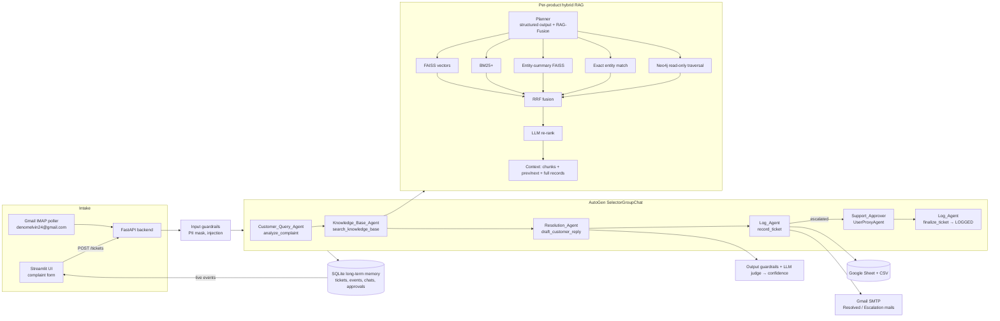

# Theofaust ventures Support — GenAI Customer Support Agent (AutoGen + Hybrid Graph RAG)

A production-style multi-agent customer support system for three products:

| Product | Documents |
|---|---|
| PureSweep V12 Robot Vacuum & Mop | shipping_policy, refund_policy, account_and_login, product_faq |
| AeroBeat X9 Wireless Noise-Cancelling Headphones | same four |
| SmartCrisp Pro 8L Wi-Fi Air Fryer | same four |

Customers raise a ticket from the **Streamlit website** or by **email to denomelvin24@gmail.com**. Four AutoGen agents (Query → Knowledge → Resolution → Log) classify the complaint, retrieve grounded passages from **that product's own** FAISS + BM25 + Neo4j knowledge, write a reply in the customer's language, and either resolve it (email + UI) or escalate it to **deno.melvin@gmail.com**, where a human approves the reply through AutoGen's `UserProxyAgent`. Every ticket is logged to Google Sheets (CSV mirror) and kept in long-term SQLite memory.

---

## 1. Architecture



**Request flow** (matches the brief):
user question → RAG-Fusion query generation → hybrid retrieval (vector + BM25 + entity-summary + exact entity) → knowledge-graph retrieval → result fusion (RRF) → re-ranking → context selection (+ neighbouring chunks, full records) → LLM → final answer with sources → judge/guardrails → resolve or escalate.

### Project layout

```
support_agent/
  config.py      settings (.env), prompts, TOKEN_PATTERN (incl. Tamil \u0B80-\u0BFF), constants
  models.py      Pydantic request/response + domain models
  llm.py         LangChain ChatOpenAI / OpenAIEmbeddings factories, truststore TLS, LangSmith
  ingest.py      .docx parsing (headings, FAQ Q&A, tables → one record per row), OCR of embedded
                 images (GPT-4o, hash-cached), KEY FACTS for non-English docs, chunking with
                 prev/next links, per-product FAISS indexes, product router index
  graph.py       Neo4j build (ingest only) + LLM-planned, validated, READ-only traversal
  planner.py     product routing (RAG), QueryPlan structured output, triage + risk flags
  retrieval.py   vector / BM25+ / entity-summary / exact-entity / graph retrievers, RRF,
                 re-rank, context builder, grounded answer generation
  guardrails.py  input + output guardrails
  resolution.py  grounded draft + confidence, escalation rules, RAG policy check
  evaluation.py  hit-rate@k, MRR, golden-set generator, LLM judge
  agents.py      AutoGen agents, tools, SelectorGroupChat, UserProxyAgent, termination
  pipeline.py    end-to-end ticket processing with deterministic fallback
  memory.py      SQLite long-term memory
  emailer.py     email templates, SMTP send, IMAP intake
  sheets.py      Google Sheets logger + CSV mirror
  services.py    shared service container
  api.py         FastAPI backend
  client.py      HTTP client used by the UI and scripts
  ui.py          Streamlit only
assets/fonts     Inter + Noto Sans Tamil (bundled, OFL)   assets/images/hero.svg
tests/           offline unit/integration tests, AutoGen wiring test, live test cases
scripts/capture_screenshots.py
```

Ingestion, planning, retrieval and agents have **no Streamlit dependency**; indexes, LLMs and drivers are passed as arguments so everything runs from scripts and tests.

---

## 2. Setup

### 2.1 Python environment
```bash
python -m venv .venv
# Windows: .venv\Scripts\activate      Linux/macOS: source .venv/bin/activate
pip install -r requirements.txt
copy .env.example .env      # Linux/macOS: cp .env.example .env   — then fill in the values
```

### 2.2 Put the product documents in `data/`
Copy your three folders (the folder name becomes the product name):
```
data/
  PureSweep V12 Robot Vacuum & Mop/                      *.docx
  AeroBeat X9 Wireless Noise-Cancelling Headphones/      *.docx
  SmartCrisp Pro 8L Wi-Fi Air Fryer/                     *.docx
```
On Windows you can instead point `DATA_DIR` in `.env` at
`C:\Users\denom\Desktop\GenAI_Training\Autogen_Buildathon_Customer support` — paths are handled with `pathlib`, nothing is hard-coded.

### 2.3 Extra services
| Service | Steps |
|---|---|
| **Neo4j** | `docker compose up -d` (uses `NEO4J_PASSWORD`) or a free Neo4j Aura instance (`neo4j+s://…`, TLS verified). Set `GRAPH_ENABLED=false` to run without it. |
| **LangSmith** | Create an API key at smith.langchain.com, set `LANGSMITH_TRACING=true` and `LANGSMITH_API_KEY`. |
| **Gmail (send + receive)** | On denomelvin24@gmail.com enable 2-Step Verification → create an **App Password** → `SUPPORT_MAILBOX_APP_PASSWORD`. Enable IMAP in Gmail settings. |
| **Google Sheets log** | Google Cloud → enable Sheets API → create a service account → download JSON to `secrets/google-service-account.json`. In the denomelvin24 Google account create a sheet, share it with the service-account email as **Editor**, put its ID in `GOOGLE_SHEET_ID`. Without this the CSV mirror is used. |
| **Corporate proxy** | `truststore` uses the OS certificate store automatically; or set `CA_BUNDLE` to a PEM. SSL verification is never disabled. |
| **Screenshots** | `python -m playwright install chromium` (or pass `--chrome` to use installed Chrome). |

### 2.4 Index the documents
```bash
python -m support_agent.ingest            # add --force to rebuild, --no-graph to skip Neo4j
```
Unchanged products are skipped (file-hash manifest). OCR, section summaries, KEY FACTS and graph extractions are cached by content hash in `storage/cache`, so re-runs don't pay twice.

---

## 3. Run
Two terminals:
```bash
run_api.bat     # or ./run_api.sh   → FastAPI on http://127.0.0.1:8000  (docs at /docs)
run_ui.bat      # or ./run_ui.sh    → Streamlit on http://localhost:8501
```
- **Customers (no login)** see only two pages: *Get help* (form + live agent timeline + reply) and *My tickets* (open any ticket with its **ticket ID + order ID**, read the reply, ask follow-up questions in the chatbot).
- **Admin (private)**: sidebar → *Staff sign-in* with `admin` / `Learning` → *Admin console* with tabs **Dashboard, Ticket log (table + CSV download), Approvals, Vector chunks, Knowledge graph**. For other users this page is not shown, and every `/admin/*` API route (including `/admin/log` and `/admin/log.csv`) returns 401 without the signed admin token.
- **Email**: customers can also raise a ticket by simply emailing **denomelvin24@gmail.com**. The API polls the inbox every `MAIL_POLL_SECONDS`; each new mail becomes a ticket and the customer immediately gets a `[Received] Ticket TKT-…` acknowledgement with the ticket ID and the order ID to use in *My tickets* (if the mail has no order ID, a private `EMAIL-XXXXXX` reference is issued). The resolution then arrives by email and in the UI. A reply whose subject contains the ticket ID is attached to that ticket's chat.

---

## 4. How each requirement is implemented

| Requirement | Implementation |
|---|---|
| AutoGen multi-agent, `AssistantAgent` per agent, `SelectorGroupChat` | `agents.build_team`. Each agent has a name, one-line `description` and focused `system_message` (`config.py`). The selector uses the LLM with `SELECTOR_PROMPT`; `candidate_func` narrows candidates to the valid next agent so the order is always Query → Knowledge → Resolution → Log. |
| Search tool with type hints + docstring, `tools=[...]`, `reflect_on_tool_use=True` | `search_knowledge_base(query: str, product: str) -> str` in `agents.make_tools`; every agent tool is passed via `tools=[...]` with `reflect_on_tool_use=True`. |
| Termination | `TextMentionTermination("LOGGED", sources=["Log_Agent"])` OR `MaxMessageTermination(MAX_AGENT_MESSAGES)` (combined with `\|`). |
| Close the model client | `run_agent_team` → `finally: await model_client.close()` (asserted in `tests/test_agent_team.py`). |
| Human-in-the-loop | `UserProxyAgent("Support_Approver", input_func=…)` waits for Approve / Edit / Reject from *Admin → Approvals*; timeout leaves the ticket "Escalated – Awaiting Approval" and the console can still finalize it later. An atomic `claim_approval` guarantees exactly one finalizer sends the email. |
| LangChain `ChatOpenAI` (not the OpenAI SDK) | All planning, re-ranking, generation, OCR, summaries, graph planning and judging use `ChatOpenAI`; embeddings use `OpenAIEmbeddings`. AutoGen agents need an AutoGen `ChatCompletionClient`, so they use `OpenAIChatCompletionClient` (AutoGen's own wrapper). |
| Customer Query Agent: RAG classification, product routing, sentiment, priority | `planner.analyze_complaint`: exact product-name match → router FAISS vote over product profiles → `QueryPlan` structured output (category, urgency, sentiment, summary, entities, filter, fusion queries) → deterministic risk-flag override. |
| Knowledge Agent: separate FAISS per product, never mix products | `storage/indexes/<product>/` holds separate chunk FAISS, summary FAISS, BM25 corpus; graph nodes carry `product` and every Cypher filters on it; the tool overrides any other product slug. |
| Resolution Agent: grounded mail reply + confidence ≥ 70% | `resolution.draft_reply`: answer only from numbered context with `[S#]` citations, tone by urgency, customer's language; confidence = weighted judge score **capped by faithfulness**; "not found" is said honestly. |
| Log Agent: Google Sheet row, escalation rules, escalation mail, RAG validation | `agents._record_ticket_sync`: rules in `resolution.evaluate_escalation` (High urgency, very angry, no matching document, legal/fraud/payment dispute, low confidence, guardrail flags) + `policy_escalation_evidence` (RAG over the product's own policies). Writes the 12 required columns. |
| Mail template with Resolved/Escalated + Ticket ID in subject | `emailer.build_subject` → `[Resolved] Ticket TKT-… \| summary`; `render_customer_email` (localised greeting/closing); escalation mail `[ESCALATION] Ticket …` with query and user details. |
| Language detection, reply in same language | `language.detect_language` (script ranges + langdetect); answer prompt sets the language. |
| Long memory | `memory.MemoryStore` (SQLite WAL): tickets, every agent event, approvals, chat turns, processed mails; previous tickets for the same email/order are fed to the planner. |
| UI store in `st.session_state` | `ui.store()` → `st.session_state["store"]`. |
| Input / output guardrails | `guardrails.check_input` (length, injection neutralised, card/CVV/OTP/ID redaction with Luhn) and `check_output` (PII, unsupported URLs, risky commitments, invalid citations, prompt leak). |
| Only retrieve from the DB / no hallucination | Answer prompt restricts to context; re-rank threshold drops irrelevant passages; judge faithfulness caps confidence; low confidence escalates. |
| Exception handling + fallback | Every retriever is isolated (one failure ≠ retrieval failure); graph down → hybrid; FAISS down → BM25; rerank failure → RRF order; planner failure → heuristic plan; team failure → `pipeline._run_fallback` runs the same tools directly; email/Sheets failures fall back to UI/CSV. Covered by `test_pipeline_fallback_without_llm_escalates_and_logs`. |
| Data ingestion (template item 1) | Sources are local `.docx`, so the web-crawling step does not apply. Tables become **one labelled record per row** with metadata (product, doc_type, source_file, section, record_id) in separate fields. |
| Document processing (item 2) | Embedded images OCR'd with GPT-4o, cached by SHA-256; non-English documents get an English KEY FACTS summary indexed alongside. |
| Query planning (item 3) | `planner.plan_query` with `with_structured_output(QueryPlan)`: standalone rewrite using chat history (follow-up chatbot), entities, doc-type filter. Context includes prev/next chunks and full matched records (`retrieval.build_context`). |
| Hybrid retrieval + graph (item 4) | `retrieval.py` — five retrievers, each callable alone; `RETRIEVAL_MODE` = `vector`, `bm25`, `hybrid`, `hybrid+graph`; RRF; graph traversal planned by the LLM (`GraphPlan`), built from a parameterised template, validated by `validate_read_only_cypher`, executed with `READ_ACCESS` + `execute_read`. |
| Multilingual tokens | `TOKEN_PATTERN` defined once in `config.py` (Latin, Devanagari, Tamil `\u0B80-\u0BFF`, Telugu, Kannada, Malayalam, Arabic, CJK) and reused by BM25, entity matching, guardrails, evaluation. |
| Portability & security | `pathlib` everywhere, bundled fonts, `.env` secrets, `truststore`, no `verify=False`, HMAC-signed admin tokens, FAISS pickles only loaded from our own ingest output. |
| Observability | LangSmith: `@traceable` on planning, every retriever, fusion, rerank, generation, judge, agent team and pipeline; LangChain calls auto-traced. |
| Evaluation | `python -m support_agent.evaluation make-golden` → `retrieval --k 5` (hit-rate@k + MRR per retrieval mode) → `answers` (LLM judge: faithfulness, relevance, completeness). |
| Dashboard + ticket log (admin only) | Tickets per category, resolved vs escalated, average urgency (Low=1, Medium=2, High=3); ticket log table with status filter and CSV download; approvals, vector chunks and knowledge-graph viewers. Enforced in the UI and in the API (`require_admin`). |
| Ticket privacy for customers | `api.ticket_access`: a ticket, its live steps and chat are returned only with the matching order ID (or an admin token); a wrong pair and an unknown ticket both return 404. |

---

## 5. Tests

```bash
python -m pytest -q                                   # 86 offline tests: no OpenAI / Neo4j / Gmail needed
python -m pytest tests/test_live_cases.py -v -s       # the two custom test cases against the running API
```
Offline coverage: ticket lifecycle (confirmation, high-priority re-escalation, auto-close, support closing), product routing (unlisted products are never answered from another product's documents), legal-threat words matched as whole words ('sue' does not fire on 'issue'), Tamil/Hindi tokenisation and language detection, RRF, hit-rate/MRR, guardrails, Cypher write-blocking, escalation rules, confidence capping, email templates (incl. acknowledgement) and inbound parsing, admin-only ticket log and dashboard, ticket access by order ID, approval claiming, .docx parsing (headings, FAQ questions, table rows), neighbour links, every retrieval mode with product isolation, the full pipeline fallback, and the **real AutoGen team** driven by a scripted model client (order, tool calls, UserProxy approval, LOGGED termination, client closed).

### Custom test cases (`tests/test_cases.json`)
| # | Case | Expected | Live result (2026-11-02) |
|---|---|---|---|
| 1 | Tamil customer: SmartCrisp air fryer shows error E3 | Product SmartCrisp, technical issue, reply **in Tamil** citing `product_faq.docx`, solution sent (green), **Pending Confirmation** until the customer says Yes | **Passed**: SmartCrisp, technical_issue, Medium, Tamil reply with the documented fix (unplug, cool 30 min, reduce load), confidence 1.00, source `product_faq.docx › 7. Error Codes & Control Panel` |
| 2 | Angry customer: AeroBeat X9 charged twice, threatens consumer forum and lawyer | High urgency, Very Negative, risk flags, **Escalated** (red), escalation mail, reply held for approval | **Passed**: AeroBeat X9, payment, High, Very Negative, *Escalated – Awaiting Approval* with reasons: High urgency, very angry, legal/payment dispute (charged twice, consumer forum, lawyer), policy requires specialist |

---

## 6. Screenshots

Captured from the running app with `scripts/capture_screenshots.py` (OpenAI, Neo4j knowledge graph and the three product folders in `data/`). The two test-case screenshots below show the agents' live results: a Tamil reply with the solution awaiting the customer's confirmation, and a legal/payment complaint escalated for human approval.

| | |
|---|---|
| **Raise a ticket**: complaint form (order ID optional)  | **My tickets**: opened with ticket ID + access code, an escalated ticket waiting for support's approval  |
| **Admin dashboard**: tickets per category, resolved vs escalated, average urgency  | **Ticket log**: the 12 logged columns, filter by status, CSV download  |
| **Approvals**: human approval of escalated replies (AutoGen `UserProxyAgent`), incl. a Tamil ticket  | **Escalations**: a legal/payment ticket that support handles directly, then sends for confirmation or closes  |
| **Vector chunks** (admin only): per-product FAISS chunks  | **Knowledge graph** (admin only)  |

### Test case screenshots
Generate these on your machine after indexing your documents with your keys in `.env`. Start the API and the UI first (`run_api.bat` and `run_ui.bat`, each in its own window), then in a third window:
```bash
python scripts/capture_screenshots.py --chrome      # submits both test cases through the UI
```
| Test case 1 – Tamil, solution sent (green, awaiting the customer's Yes) | Test case 2 – legal/payment, Escalated (red, awaiting approval) |
|---|---|
|  |  |

### Evaluation results
Golden set: 30 questions (10 per product) generated from the product documents with `python -m support_agent.evaluation make-golden --per-product 10`; each question's correct answer is the section it was written from. Reports: `eval/report_retrieval.json`, `eval/report_answers.json`.

**Retrieval** (`python -m support_agent.evaluation retrieval --k 5`, re-ranking off for a fair comparison):

| Retrieval mode | Hit-rate@5 | MRR@5 |
|---|---|---|
| Keyword (BM25) | 0.833 | 0.619 |
| Semantic (vector, FAISS) | 0.933 | 0.867 |
| Hybrid (vector + BM25, RRF) | 0.967 | 0.814 |
| **Hybrid + knowledge graph** (used by the app) | **0.967** | **0.853** |

Combining searches finds the right section more often than either search alone (29 of 30 questions vs 25 for keyword and 28 for semantic search), and the knowledge graph moves it higher in the ranking than plain hybrid. With 30 questions one question is worth 3.3 points, so small MRR differences between modes are within noise.

**Answer quality** (`python -m support_agent.evaluation answers --limit 10`, LLM-as-judge):

| Faithfulness | Relevance | Completeness | Confidence |
|---|---|---|---|
| 1.00 | 1.00 | 1.00 | 1.00 |

On 10 document-based questions the judge found no unsupported claims. These questions each come from one section, so they are easier than real complaints, and the judge is from the same model family as the writer. Harder behaviour (unlisted products, legal threats, a Tamil complaint, low confidence) is covered by the two custom test cases, the escalation rules and the offline tests. A stricter check: score all 30 questions (`--limit 30`) and set `OPENAI_JUDGE_MODEL` to a stronger model than `OPENAI_CHAT_MODEL`.

---

## 7. Configuration reference
All settings live in `.env` (see `.env.example`). Key ones: `RETRIEVAL_MODE`, `RAG_FUSION_QUERIES`, `TOP_K_PER_RETRIEVER`, `FINAL_CONTEXT_K`, `RERANK_ENABLED`, `MIN_RERANK_SCORE`, `CONFIDENCE_THRESHOLD`, `APPROVAL_TIMEOUT_SECONDS`, `MAX_AGENT_MESSAGES`.

## 8. Notes and limits
- `langchain-community` (FAISS wrapper) prints a deprecation notice; it is pinned and works. The FAISS wrapper is isolated in `ingest.py`/`retrieval.py` if you later migrate.
- Run one API worker (`uvicorn` default): background ticket tasks and the mail poller live in-process.
- Customer emails: the answer is written in the customer's language, but the fixed template lines (Ticket ID / Status labels, "Did this solve your issue?", closing) are in English. Localising those lines is a planned improvement.
- The "policy requires specialist handling" escalation reason comes from keyword matching over the product's policies and can list loosely related sections; the other escalation rules decide independently.
